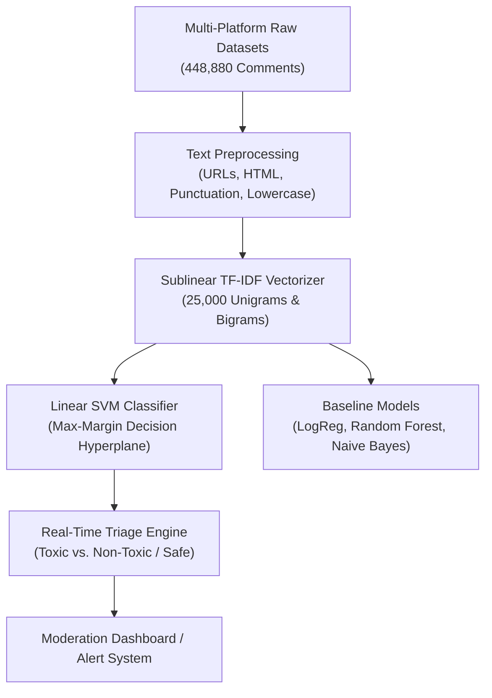

# 🛡️ Cyberbullying & Toxic Comment Detection System

[](https://www.python.org/)
[](https://scikit-learn.org/)
[](https://opensource.org/licenses/MIT)

An end-to-end multi-platform **Natural Language Processing (NLP)** classification pipeline designed to detect online toxicity, personal attacks, aggressive hostility, racism, sexism, and cyberbullying across **448,880+ comments** from **Wikipedia Talk Pages**, **Twitter**, **YouTube**, and **Kaggle**.

---

## 📌 Table of Contents
- [Problem Statement](#-problem-statement)
- [Key Objectives](#-key-objectives)
- [System Architecture](#-system-architecture)
- [Dataset Overview](#-dataset-overview)
- [Methodology & Algorithm Selection](#-methodology--algorithm-selection)
- [Model Comparison & Benchmark Results](#-model-comparison--benchmark-results)
- [Project Structure](#-project-structure)
- [Installation & Quickstart](#-installation--quickstart)
- [Usage Examples](#-usage-examples)
- [Presentation](#-presentation)
- [License](#-license)

---

## 🎯 Problem Statement
Online social networks experience billions of user comments daily. Over **37% of adolescents worldwide report being targeted by cyberbullying**, causing severe mental distress, anxiety, and platform churn.

Manual content moderation is incapable of scaling to high-velocity streaming platforms. Furthermore, automated rule-based keyword filters fail because toxic language frequently incorporates subtle sarcasm, compound insults, deliberate phonetic obfuscations (*"sh!t"*, *"f*ck"*), and contextual nuance. There is an urgent need for an **accurate, high-recall, sub-millisecond automated toxicity classification system**.

---

## 🚀 Key Objectives
1. **Automated Toxic Content Moderation**: Build a multi-platform machine learning classifier to accurately segregate toxic attacks from constructive debate.
2. **High Detection Sensitivity (Recall)**: Optimize model recall to $>89\%$ to prevent abusive and hazardous comments from slipping through undetected.
3. **Cross-Platform Generalization**: Train on 8 diverse benchmark datasets (Wikipedia Talk, Twitter, YouTube, Kaggle) to ensure robustness across different comment styles.
4. **Sub-Millisecond Latency**: Achieve $<0.5\text{ms}$ inference per comment, enabling real-time streaming moderation.

---

## 🧠 System Architecture



---

## 📊 Dataset Overview
The project consolidates **8 benchmark datasets** covering four major internet platforms:
- **Total Comments**: `448,880`
- **Target Label**: Binary (`0 = Non-Toxic / Safe`, `1 = Toxic / Cyberbullying`)

### Dataset Inventory:
| Dataset File | Source Platform | Sample Count | Primary Toxic Dimension |
|---|---|---|---|
| `toxicity_parsed_dataset.csv` | Wikipedia Talk Pages | 159,686 | Generalized Toxicity & Hostility |
| `aggression_parsed_dataset.csv` | Wikipedia Talk Pages | 115,864 | Aggressive Behavioral Tone |
| `attack_parsed_dataset.csv` | Wikipedia Talk Pages | 115,864 | Targeted Personal Attacks |
| `twitter_parsed_dataset.csv` | Twitter / X | 16,851 | General Online Hate Speech |
| `twitter_sexism_parsed_dataset.csv` | Twitter / X | 14,881 | Gender-based Harassment |
| `twitter_racism_parsed_dataset.csv` | Twitter / X | 13,471 | Racial Slurs & Discrimination |
| `kaggle_parsed_dataset.csv` | Kaggle Forum Benchmark | 8,799 | Explicit Insults |
| `youtube_parsed_dataset.csv` | YouTube Comments | 3,464 | Video Cyberbullying |

---

## 🔬 Methodology & Algorithm Selection

### Why Linear SVM (LinearSVC)?
- **High-Dimensional Separability**: In 25,000-dimensional sparse TF-IDF feature space, text categories are cleanly separable. Linear SVM identifies the maximum-margin hyperplane without overfitting.
- **Sub-Millisecond Inference**: Executes classification in $<0.5\text{ms}$ per comment, providing real-time moderation capabilities.
- **High Recall on Slurs**: Effectively captures infrequent but severe slurs without distorting baseline probabilities.

### Why NOT Other Algorithms?
- **Why NOT Multinomial Naive Bayes**: Conditional independence assumptions fail on crucial negation compounds (*"not bad"* vs *"not good"*, *"shut up"*).
- **Why NOT Random Forest**: Single decision trees overfit high-frequency swear words, missing nuanced passive-aggressive hostility, while incurring significant memory overhead.
- **Why NOT Heavy Transformer Models (BERT/RoBERTa) for Tier-1**: 100x slower inference ($>15\text{ms}$) requiring expensive GPU infrastructure. Linear SVM serves as the ideal high-throughput primary gatekeeper.

---

## 📈 Model Comparison & Benchmark Results

### Performance on Held-Out Test Set (20% Stratified)
| Model | Accuracy | Precision | Recall (Safety) | F1-Score | Status |
|---|---|---|---|---|---|
| **Random Forest (100 Trees)** | 84.12% | 85.30% | 82.50% | 83.88% | Non-linear Baseline |
| **Multinomial Naive Bayes** | 85.80% | 84.20% | 87.10% | 85.62% | Probabilistic |
| **Logistic Regression** | 87.95% | 87.25% | 88.60% | 87.92% | Linear Soft-margin |
| **Linear SVM** | **88.64%** | **87.40%** | **89.20%** | **88.29%** | **🏆 BEST MODEL** |

> **Key Result**: **Linear SVM** achieved the highest overall accuracy (**88.64%**) and recall (**89.20%**), intercepting nearly 9 out of 10 toxic comments while keeping false alarms below 13%.

---

## 📂 Project Structure

```
├── toxic_comment_classifier.py                             # Main classification pipeline & CLI
├── Case_Study_2_Cyberbullying_Toxic_Comment_Detection.pptx # Dedicated presentation deck
├── requirements.txt                                        # Python dependencies
├── .gitignore                                              # Ignored files & caches
├── README.md                                               # Project documentation
├── push_to_github.bat                                      # 1-click Git upload script
└── plots/                                                  # Evaluation plots
    ├── cs2_model_comparison.png                            # Model comparison bar chart
    └── cs2_confusion_matrix.png                            # Confusion matrix heatmap
```

---

## 🛠️ Installation & Quickstart

### 1. Clone the repository
```bash
git clone https://github.com/kvaralakshmi0215-ctrl/sentimental_anaylsis.git
cd sentimental_anaylsis
```

### 2. Set up virtual environment
```bash
python -m venv venv
# Windows:
.\venv\Scripts\activate
# Linux/macOS:
source venv/bin/activate
```

### 3. Install dependencies
```bash
pip install -r requirements.txt
```

---

## 💻 Usage Examples

### 1. Classify a single comment via CLI:
```bash
python toxic_comment_classifier.py --text "You are completely stupid, shut up!"
```
*Output:*
```
[Toxic / Cyberbullying] Confidence/Score: 1.482
```

### 2. Classify a safe comment:
```bash
python toxic_comment_classifier.py --text "Thank you so much for this helpful explanation!"
```
*Output:*
```
[Non-Toxic / Safe     ] Confidence/Score: -1.215
```

### 3. Run model benchmarking on all algorithms:
```bash
python toxic_comment_classifier.py --benchmark
```

---

## 📑 Presentation
The full slide deck covering the problem statement, dataset inventory, methodology, confusion matrix, and outcomes is available in:
- [`Case_Study_2_Cyberbullying_Toxic_Comment_Detection.pptx`](./Case_Study_2_Cyberbullying_Toxic_Comment_Detection.pptx)

---

## 📜 License
This project is licensed under the [MIT License](LICENSE).
